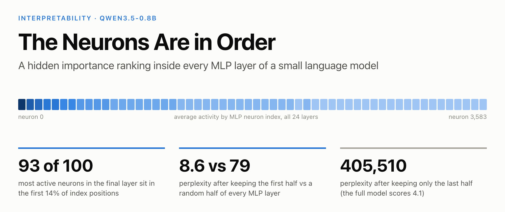
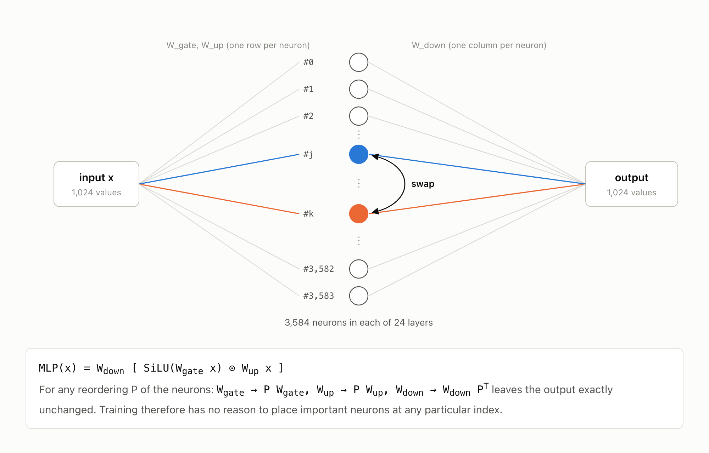
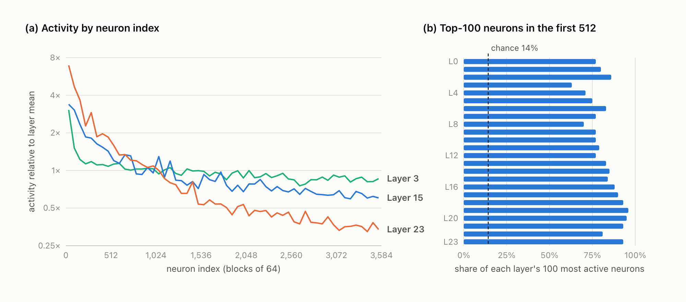
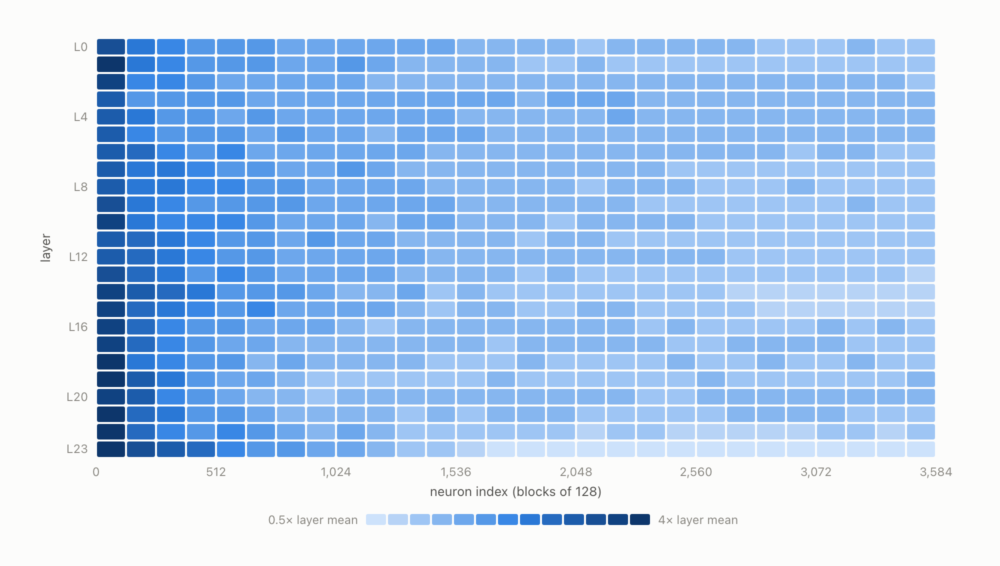
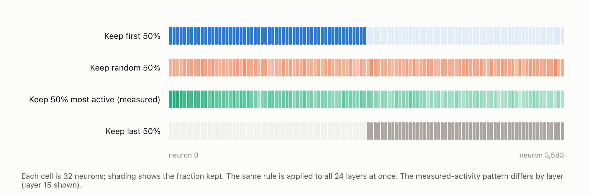
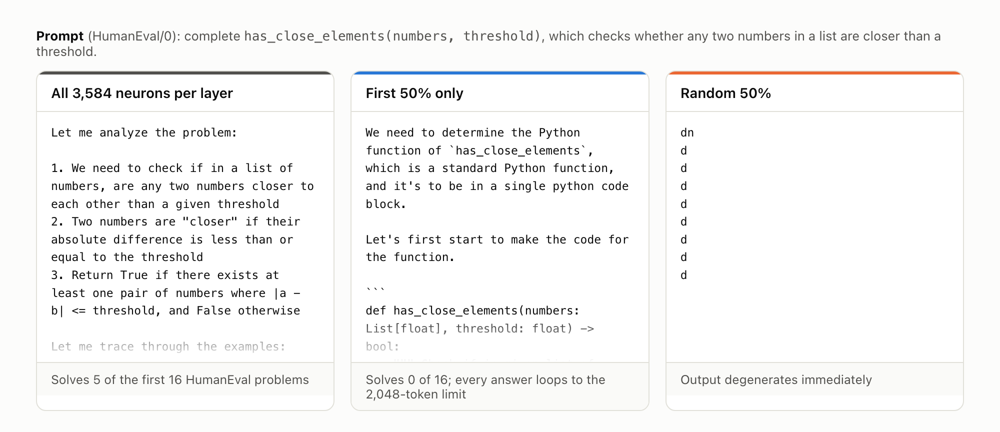
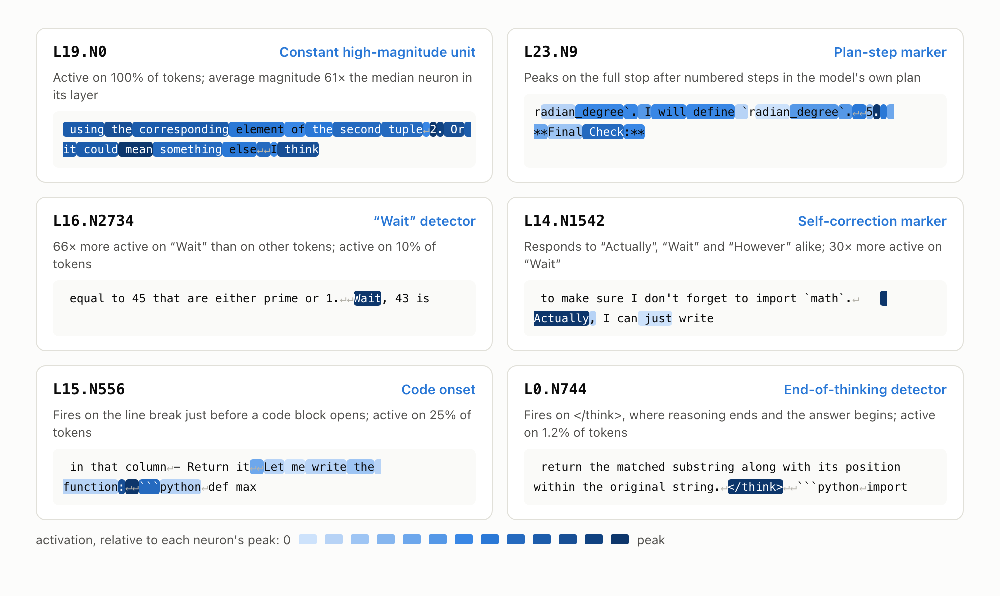

# The Neurons Are in Order (and They Shouldn't Be)



**TL;DR.** The MLP neurons of Qwen3.5-0.8B are stored in what looks like order of importance. In every one of its 24 layers, the most active neurons are packed into the lowest indices. Across layers, 63% to 96% of each layer's 100 most active neurons sit in the first 512 of 3,584 positions, where chance would put 14%. The ordering is not just a statistic. Keeping only the first half of every MLP layer raises perplexity on Python code from 4.1 to 8.6. Keeping a random half raises it to 79, and keeping the last half raises it to over 400,000. The front half on its own still writes fluent, on-topic text, but it cannot finish solving a single programming problem. A random half outputs the letter "d", repeatedly.

Nothing in standard training should produce this structure. We think it is a fingerprint of how the model was built, and it has practical consequences for compression and for interpretability research.

---

We came across this while working on a different question. Our main project tries to make Qwen3.5-0.8B solve more coding problems with fewer tokens by editing a small number of its weights directly, without any training. The approach follows recent work on weight-space programming [1]. Part of that work means locating the neurons behind specific behaviours, in particular the model's habit of second-guessing correct answers.

One of those searches returned the 64 neurons in the final layer most associated with overly long reasoning:

```text
28, 84, 11, 234, 36, 6, 291, 2, 57, 77, 81, 66, 15, 160, 49, 176, ...
```

The layer has 3,584 neurons. A set of 64 important neurons should be spread across the whole range. Instead, 56 of the 64 had an index below 512. That is very unlikely to happen by chance, so we looked further.

## Neuron order should carry no information

Each transformer layer in Qwen3.5-0.8B contains a gated MLP (SwiGLU [2]) with 3,584 hidden neurons. Neuron *j* reads the input through row *j* of the gate and up projections, and writes its output through column *j* of the down projection.



*Figure 1. Swapping two neurons, together with their rows and columns of weights, leaves the layer's function exactly unchanged. This permutation symmetry holds for any reordering of the 3,584 neurons.*

This is a classical property of neural networks [3, 4]. Because every reordering of the neurons computes the same function, gradient descent from a random initialisation has no mechanism for placing important neurons at low indices. In an ordinarily trained model, the index of a neuron should tell you nothing about it.

## Experiment 1: Is activity related to neuron index?

**Setup.** We recorded the activation of every MLP neuron (24 layers × 3,584 neurons) while the model answered 128 programming problems from MBPP [5], and measured each neuron's average activation magnitude.



*Figure 2. (a) Average activation per block of 64 neurons, relative to the layer mean, for three layers. (b) For each layer, the share of its 100 most active neurons whose index is below 512. The dashed line marks the share expected by chance.*

Activity declines steadily with index. In the final layer, neurons 0 to 511 are on average 9× more active than neurons 3,072 to 3,583. The effect is not limited to a few layers. In every layer, between 63% and 96% of the 100 most active neurons have an index below 512, against 14% expected by chance.



*Figure 3. Average activation for every layer (rows) and every block of 128 neurons (columns), relative to the layer mean. All 24 layers show the same concentration at low indices, and the gradient becomes steeper with depth.*

The weights carry the same signature without running the model at all: in the deeper layers, the norm of each neuron's output weights varies smoothly with its index. Across the model, a neuron among the first 512 is active on about 25% of tokens, against 8% for a neuron among the last 512.

## Experiment 2: Does index order encode importance?

High activity does not imply importance. A neuron can be busy and still contribute little. To test importance directly, we removed neurons and measured the damage.

**Setup.** A neuron is removed by zeroing its output weights, which is exactly equivalent to deleting it. We applied four selection rules to all 24 layers simultaneously, keeping 25%, 50% or 75% of the neurons. We then measured perplexity on Python code (MBPP reference solutions) and on English prose; lower is better.



*Figure 4. The selection rules, illustrated for the 50% case. "Most active" uses the activation measurements from Experiment 1, chosen separately for each layer.*


*Figure 5. Perplexity after keeping a fraction of the neurons in every MLP layer (log scale). The shaded band shows the range over three random draws.*

| Neurons kept | First (by index) | Random (3 draws) | Most active (measured) | Last (by index) |
|---|---|---|---|---|
| 100% | 4.1 | 4.1 | 4.1 | 4.1 |
| 75% | **5.5** | 9.8 to 13.7 | | |
| 50% | **8.6** | 60 to 91 | 9.0 | 405,510 |
| 25% | **16.4** | 3,237 to 17,788 | | |

*Perplexity on Python code. English prose follows the same pattern: 71 for the first half, 333 to 569 for a random half, and 448,224 for the last half.*

Three observations:

1. **The first half outperforms a random three-quarters.** Removing half of every layer in index order (8.6) costs less than removing a random quarter (9.8 to 13.7).
2. **The last half alone does not function.** Perplexity rises from 4.1 to over 400,000, higher than the 248,320 that a uniform guess over the entire vocabulary would score.
3. **Index order beats our own measurement.** Keeping the 50% of neurons we measured as most active gives 9.0 on code and 90 on prose, slightly worse than plain index order (8.6 and 71). Whatever produced the ordering had better information about the neurons than activation statistics do.

## Experiment 3: What does the reduced model produce?

Perplexity is an aggregate. To see what the reduced models actually do, we gave each version the first HumanEval [6] problem and let it generate.



*Figure 6. The opening of each model's response to the same prompt.*

The full model starts with a structured analysis. The model reduced to its first half produces grammatical, on-topic text and even begins writing the correct function signature. The randomly reduced model outputs a single character repeatedly.

We then evaluated the first-half model on the first 16 HumanEval problems. It solved none. In all 16 cases, the response entered a repetitive loop and ran to the 2,048-token limit, for example: *"The function's function is defined, and the `count_distinct_characters` is a function that returns the number of distinct characters…"*. The full model solves 5 of the same 16 problems.

The front of each layer is enough to preserve language: grammar, topic and code syntax survive. Multi-step problem solving needs the remaining neurons.

## Experiment 4: What do individual neurons do?

**Setup.** We profiled every neuron on about 185,000 tokens of the model's own reasoning traces, Python code and English text. For each neuron we recorded how often it is active, how selectively it responds to particular tokens, and the contexts that activate it most strongly.

First, where do the different kinds of neurons sit?


*Figure 7. Index position of each layer's 1% most active neurons (blue) and 1% most token-selective neurons (orange), pooled over all layers.*

The two groups behave very differently. Of the most active neurons, 98% are among the first 512. Token-selective neurons, which respond strongly to one kind of token and stay quiet otherwise, are spread across the whole range, with only a mild tilt toward the front (19% in the first block, 9% in the last). The ordering ranks neurons by how much they contribute overall, not by what they represent.



*Figure 8. Six neurons, each shown on the passage of the model's own reasoning where it responds most strongly. Shading shows activation magnitude relative to that neuron's peak. Neurons are named layer.neuron, so L16.N2734 is neuron 2,734 in layer 16.*

A few of these are worth describing in more detail.

- **L19.N0** sits at index 0 and is active on every token. Its average magnitude is 61× that of the median neuron in its layer. Single neurons with outsized, nearly constant activations have been documented across many language models as *massive activations* [7]. They appear to act as fixed reference points rather than as carriers of specific content.
- **L16.N2734** is 66× more active on the token "Wait" than on other tokens in the model's reasoning, and inactive on 90% of text. This is relevant to our main project: elsewhere we found that the model says "Wait" after correct code almost as often as after incorrect code.
- **L14.N1542** responds in the same way to "Actually", "Wait" and "However" when they open a sentence. It appears to encode the act of revising a previous statement rather than any single word.
- **L15.N556** activates on the line break immediately before a code block, after phrases such as "Let me write the function:". It responds before any code has been written.

Other specialists include two neurons (L0.N545 and L15.N1126) that are about 76× more active on `def` than on average, one (L0.N1427) that is 67× more active on `return`, and one (L0.N744) that responds to `</think>`, the token where the model ends its reasoning and begins its answer.

Neurons are frequently polysemantic [8], so these labels describe the strongest pattern we observed, not a neuron's complete function.

## What could produce this ordering?

We do not know how Qwen3.5-0.8B was built, so this section is a hypothesis. Two established techniques would leave exactly this signature.

**Structured pruning from a larger model.** Methods such as Minitron [9] and Sheared LLaMA [10] rank the neurons of a larger model by importance, keep the highest-ranked ones, and retrain with distillation. If the retained neurons are stored in rank order, the smaller model inherits a sorted MLP.

**Nested-width training.** Methods such as MatFormer [11], building on Matryoshka representation learning [12], train a model so that its first *k* neurons form a functional smaller model by themselves. Under this scheme, the front of every layer is a compact model by design.

The results in Experiments 2 and 3 are consistent with either explanation: cutting along the index order preserves far more of the model than any other cut we tried.

## Implications

- **Compression without training.** If each layer's front portion is a ranked core, the model can be shrunk by slicing alone. The half-width model is weaker today (perplexity 8.6 against 4.1, no solved problems), but it is a far better starting point for recovery than any random subset.
- **A map for interpretability.** In this model, the neurons that carry most of the computation are concentrated in a known region of every layer.
- **A pitfall for neuron-level studies.** Many interpretability and pruning studies use a random set of neurons as a control, assuming neuron indices are exchangeable. In a model with this structure, that assumption fails, and comparisons against index-based subsets can be misleading.

## What comes next

This is a side result from a larger, ongoing project. Our main goal is to get more solved problems per token from Qwen3.5-0.8B by editing a very small number of its weights directly, without training. Earlier work in the project found that a large share of the model's tokens is spent reconsidering a first draft, and that this extra reasoning rarely changes the outcome. The findings here feed into that work in three ways, and we are pursuing each of them next.

1. **Targeted edits to the doubt circuitry.** L16.N2734 and L14.N1542 are concrete candidates for the second-guessing behaviour. Next, we will test whether adjusting a handful of neurons like these reduces wasted reasoning without hurting accuracy.
2. **A free draft model.** If the front of every layer is a functional core, a sliced copy of the model could serve as a cheap draft model for speculative decoding [13], with the full model verifying its proposals. That would reduce the cost of every answer without changing the answers themselves.
3. **Where the ordering comes from.** We plan to check whether other members of the Qwen3.5 family show the same structure, and whether the hidden smaller model can be recovered cleanly.

We will report results as they come in.

## Limitations

- All results are from a single model, Qwen3.5-0.8B. Other models, including other Qwen3.5 sizes, have not yet been checked.
- Perplexity was measured on a modest amount of text: about 21,000 tokens of code and 18,000 tokens of prose.
- The problem-solving evaluation of the half-width model covers 16 HumanEval problems. That is enough to show a collapse from 5 solved to 0, but not to estimate a precise success rate.
- Neuron profiles come from about 185,000 tokens, most of them code and reasoning about code. Profiles on other kinds of text may differ.
- "Sorted by importance" is our interpretation of the evidence. We have not confirmed how the model was produced.

## References

1. Takehi, R., Teoh, J., Zhang, A. and Khattab, O. (2026). *Sparks of Weight-Space Programming: LLMs can natively read & write neural network weights.* Blog post, MIT CSAIL. https://rikiyat.github.io/blog/weight-space-programming/
2. Shazeer, N. (2020). *GLU Variants Improve Transformer.* arXiv:2002.05202.
3. Hecht-Nielsen, R. (1990). *On the algebraic structure of feedforward network weight spaces.* In Advanced Neural Computers, Elsevier.
4. Ainsworth, S., Hayase, J. and Srinivasa, S. (2023). *Git Re-Basin: Merging Models modulo Permutation Symmetries.* ICLR 2023.
5. Austin, J. et al. (2021). *Program Synthesis with Large Language Models.* arXiv:2108.07732.
6. Chen, M. et al. (2021). *Evaluating Large Language Models Trained on Code.* arXiv:2107.03374.
7. Sun, M., Chen, X., Kolter, J. Z. and Liu, Z. (2024). *Massive Activations in Large Language Models.* COLM 2024. arXiv:2402.17762.
8. Elhage, N. et al. (2022). *Toy Models of Superposition.* Transformer Circuits Thread.
9. Muralidharan, S. et al. (2024). *Compact Language Models via Pruning and Knowledge Distillation.* NeurIPS 2024. arXiv:2407.14679.
10. Xia, M., Gao, T., Zeng, Z. and Chen, D. (2024). *Sheared LLaMA: Accelerating Language Model Pre-training via Structured Pruning.* ICLR 2024.
11. Devvrit, Kudugunta, S. et al. (2023). *MatFormer: Nested Transformer for Elastic Inference.* arXiv:2310.07707.
12. Kusupati, A. et al. (2022). *Matryoshka Representation Learning.* NeurIPS 2022.
13. Leviathan, Y., Kalman, M. and Matias, Y. (2023). *Fast Inference from Transformers via Speculative Decoding.* ICML 2023.

## Citation

```bibtex
@misc{divekar2026neuronorder,
  title        = {The Neurons Are in Order (and They Shouldn't Be)},
  author       = {Divekar, Advik},
  year         = {2026},
  month        = nov,
  howpublished = {\url{https://github.com/advikdivekar/qwen-neuron-order}},
  note         = {Blog post}
}
```
