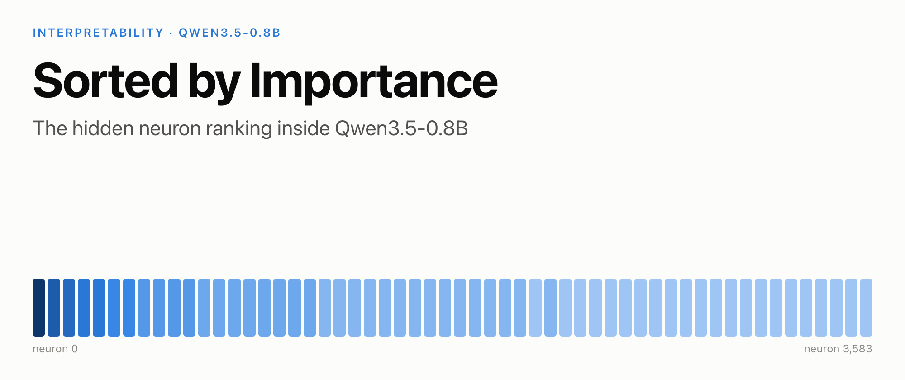
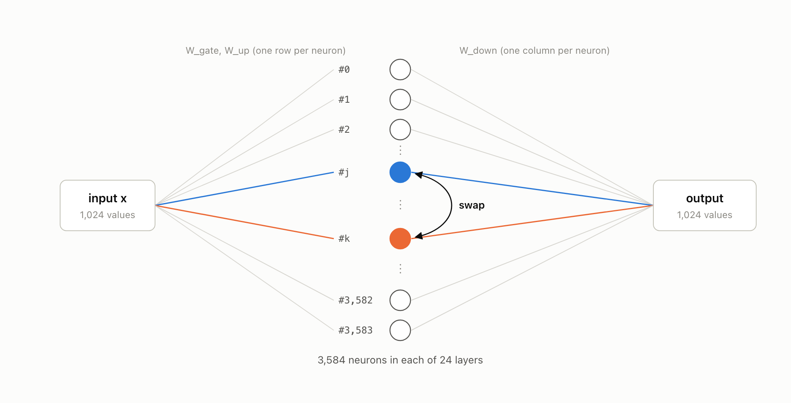
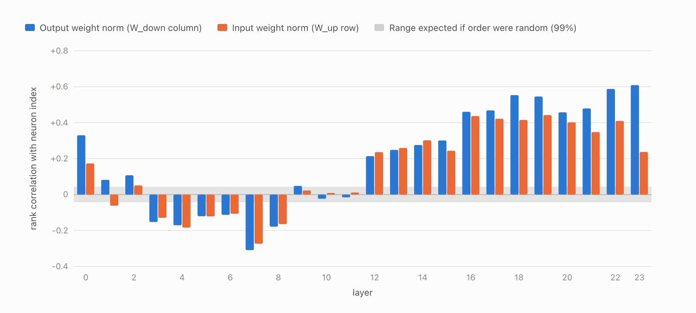
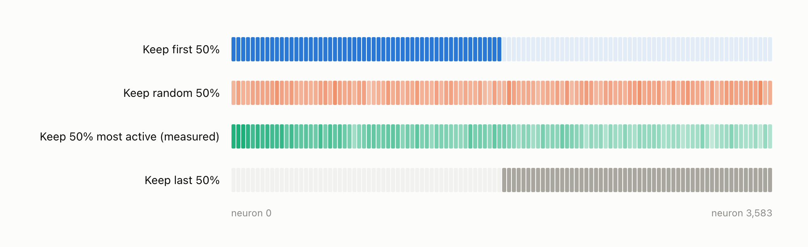
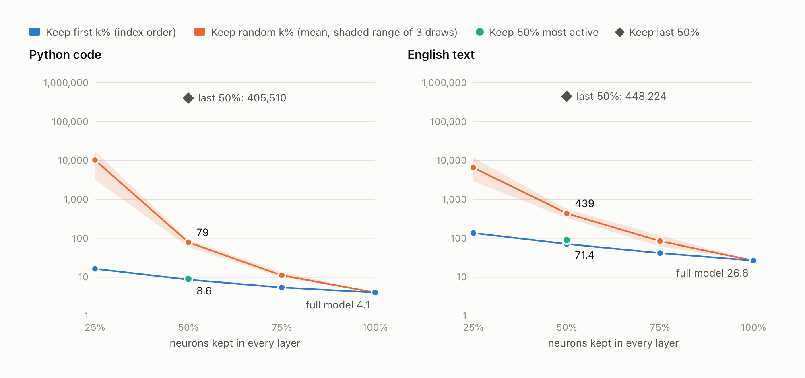
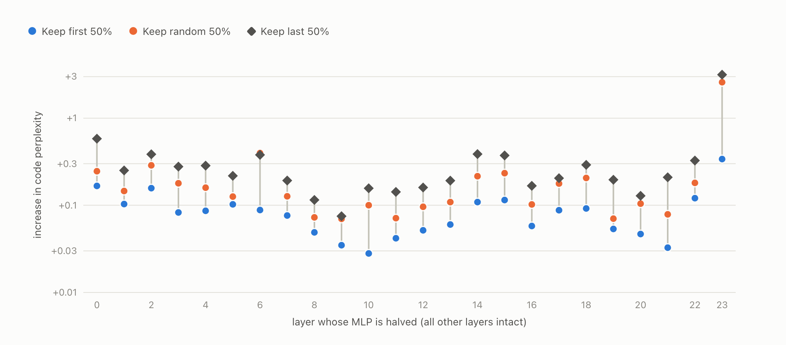
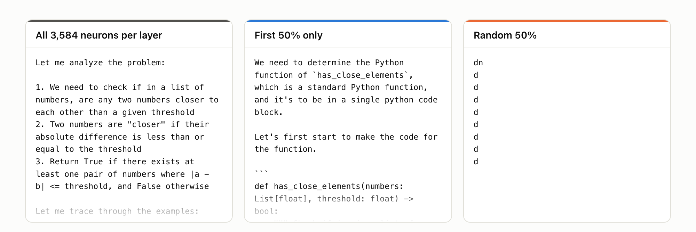
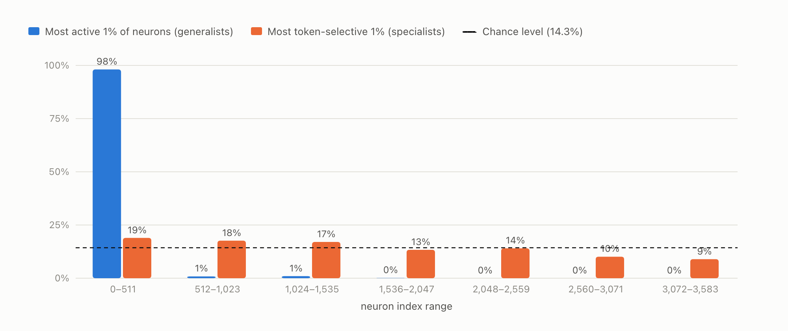
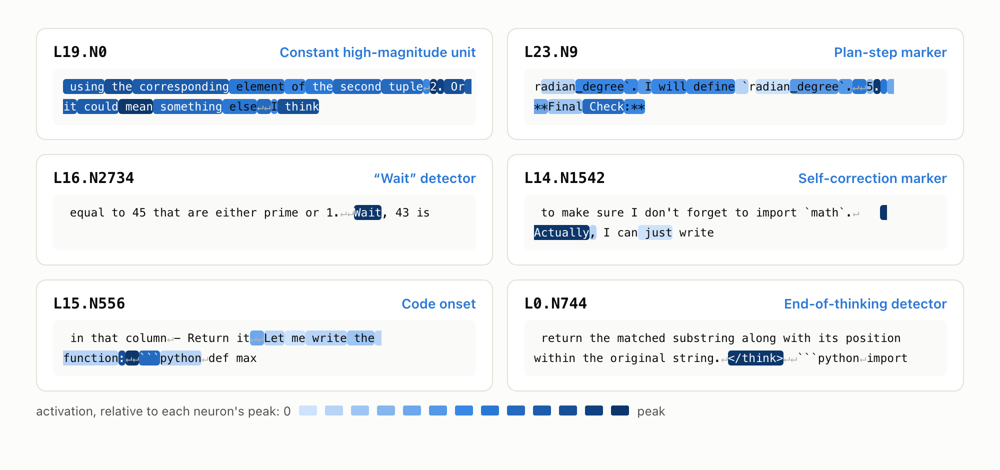

# Sorted by Importance: The Hidden Neuron Ranking Inside Qwen3.5-0.8B



**TL;DR.** The MLP neurons of Qwen3.5-0.8B appear to be stored in order of importance. In every one of its 24 layers, the most active neurons are packed into the lowest indices. Depending on the layer, 63% to 96% of the 100 most active neurons sit in the first 512 of 3,584 positions, where chance would put 14%. The ordering is also visible in the raw weights, before the model processes a single token. It matters in practice:

- keeping only the first half of every MLP layer raises perplexity on Python code from 4.1 to 8.6;
- keeping a random half raises it to 79;
- keeping the last half raises it to over 400,000.

The front half on its own still writes fluent, on-topic text, but it cannot finish a single programming problem. A random half outputs the letter "d", over and over.

Standard training should not produce this structure. I think it is a fingerprint of how the model was built, and it has practical consequences for compression and for interpretability research.

---

I found this while working on something else. My main project tries to make Qwen3.5-0.8B solve more coding problems with fewer tokens by editing a small number of its weights directly, without any training. The approach is inspired by recent work on weight-space programming [1]. A large part of that work is locating the neurons behind specific behaviours, in particular the model's habit of second-guessing answers that are already correct.

One of those searches returned the 64 neurons in the final layer most associated with overly long reasoning:

```text
28, 84, 11, 234, 36, 6, 291, 2, 57, 77, 81, 66, 15, 160, 49, 176, ...
```

The layer has 3,584 neurons, so 64 important ones should be spread across the whole range. Instead, 56 of the 64 had an index below 512. If neuron indices carried no information, that would almost never happen. So I looked further.

## Background: neuron order should carry no information

Each transformer layer in Qwen3.5-0.8B contains a gated MLP (SwiGLU [2]) with 3,584 hidden neurons. Neuron *j* reads the layer's input through row *j* of two input matrices, the gate and up projections. It writes its result back through column *j* of the down projection:

```text
MLP(x) = W_down · ( SiLU(W_gate · x) ⊙ (W_up · x) )
```



**Figure 1.** Each neuron in an MLP layer connects to the input through its own row of W_gate and W_up, and to the output through its own column of W_down. Exchanging two neurons, here #j and #k, together with those rows and that column, changes nothing about what the layer computes. The same holds for any reordering P of all 3,584 neurons: replacing W_gate with P·W_gate, W_up with P·W_up and W_down with W_down·Pᵀ gives exactly the same output.

This permutation symmetry is a classical property of neural networks [3, 4]. Every ordering of the neurons computes the same function. So gradient descent from a random initialisation has no mechanism for placing important neurons at low indices. In an ordinarily trained model, a neuron's index should tell you nothing about it.

## Experiment 1: Is activity related to neuron index?

I recorded the activation of every MLP neuron (24 layers × 3,584 neurons) while the model answered 128 programming problems from MBPP [5], and computed each neuron's average activation magnitude.


**Figure 2.** (a) Average activation of each block of 64 neurons, divided by the layer's overall average, for layers 3, 15 and 23. A value of 1× means "as active as a typical neuron in that layer"; the vertical axis is logarithmic. In all three layers the curve starts high at neuron 0 and falls, most steeply in the final layer. (b) For each of the 24 layers, the share of its 100 most active neurons whose index is below 512. The dashed line marks the 14% expected if index and activity were unrelated. Every layer is far above it.

In the final layer, neurons 0 to 511 are on average 9× more active than neurons 3,072 to 3,583. The effect is not confined to a few layers: in every layer, between 63% and 96% of the 100 most active neurons have an index below 512.


**Figure 3.** Each row is a layer (0 at the top, 23 at the bottom), and each cell is a block of 128 neurons. Darker cells are more active relative to the layer average, from 0.5× (lightest) to 4× (darkest). Every layer has the same dark band at the far left, and the contrast between front and back grows with depth.

Across the whole model, a neuron among the first 512 is active on about 25% of tokens, against 8% for a neuron among the last 512.

## Experiment 2: The order is visible in the weights alone

Activations depend on the input text, so I also checked whether the ordering shows up in the raw parameters, without running the model at all. For every layer, I computed the rank correlation between a neuron's index and the size (Euclidean norm) of its weights.



**Figure 4.** For each layer, the rank correlation between neuron index and the norm of that neuron's output weights (blue: its column of W_down) and input weights (orange: its row of W_up). The grey band shows the range expected 99% of the time if the order were random (±0.04). Most layers fall well outside it.

If the neurons were in arbitrary order, these correlations would sit inside the grey band. Instead they reach −0.31 in layer 7 and +0.61 in layer 23. The sign flips with depth. In the early layers, the front neurons have larger weights; from layer 12 onward, the *back* neurons do, even though they are the least active. One reading is that the rarely used neurons at the back have large weights so that they make a strong contribution on the few tokens where they do fire. Either way, the order is written into the parameters themselves: anyone can see it by loading the weight file.

## Experiment 3: Does index order encode importance?

High activity does not imply importance; a neuron can be busy and still contribute little. To test importance directly, I removed neurons and measured the damage.

A neuron is removed by zeroing its output weights, which is exactly equivalent to deleting it. I applied four selection rules to all 24 layers at once, keeping 25%, 50% or 75% of the neurons. I then measured perplexity, a standard measure of how well a model predicts text where lower is better, on Python code (MBPP reference solutions) and on English prose.



**Figure 5.** The four selection rules, shown for the 50% case. Each cell stands for 32 neurons, and its shading shows the fraction kept. "Keep first" retains neurons 0 to 1,791. "Keep random" retains a random half. "Keep most active" retains the half measured as most active in Experiment 1; that choice differs by layer, and layer 15 is shown. "Keep last" retains neurons 1,792 to 3,583. The same rule is applied to every layer simultaneously.



**Figure 6.** Perplexity after keeping 25%, 50%, 75% or 100% of the neurons in every layer, on Python code (left) and English prose (right). The vertical axis is logarithmic, so each gridline is ten times the one below. Blue: keeping the first neurons by index. Orange: keeping a random subset (the line is the mean of three draws, the band their range). Green: keeping the 50% measured as most active. Diamond: keeping the last 50%.

| Neurons kept | First (by index) | Random (3 draws) | Most active (measured) | Last (by index) |
|---|---|---|---|---|
| 100% | 4.1 | 4.1 | 4.1 | 4.1 |
| 75% | **5.5** | 9.8 to 13.7 | | |
| 50% | **8.6** | 60 to 91 | 9.0 | 405,510 |
| 25% | **16.4** | 3,237 to 17,788 | | |

*Perplexity on Python code. English prose follows the same pattern: 71 for the first half, 333 to 569 for a random half, and 448,224 for the last half.*

Three observations:

1. **The first half outperforms a random three-quarters.** Removing half of every layer in index order (8.6) costs less than removing a random quarter (9.8 to 13.7).
2. **The last half alone does not function.** Perplexity rises above 400,000. That is higher than the 248,320 that a uniform guess over the model's entire vocabulary would score.
3. **Index order beats my own measurement.** Keeping the 50% of neurons I measured as most active gives 9.0 on code and 90 on prose, slightly worse than plain index order (8.6 and 71). Whatever produced the ordering had better information about these neurons than activation statistics do.

## Experiment 4: One layer at a time

Removing half of every layer at once lets the damage compound. To see how much each layer depends on the ordering by itself, I halved the MLP of a single layer, left the other 23 intact, and measured perplexity on Python code. I did this for every layer and all three selection rules. The unmodified model scores 4.02 on this 8,000-token sample.



**Figure 7.** The increase in code perplexity when only one layer's MLP is cut in half. Each column is one layer. The three markers show the three ways of choosing which half to keep: first by index (blue), random (orange) and last by index (dark diamond). The grey line connects them. The vertical axis is logarithmic, so the gap between blue and orange is larger than it looks.

The result is the same in every layer. **In all 24 layers, keeping the first half does less damage than keeping a random half, and less than keeping the last half.** Averaged over layers, perplexity rises by 0.09 when the first half is kept, 0.26 for a random half and 0.37 for the last half. Any single layer can lose half its neurons at small cost; it is the accumulation over 24 layers that produces the large numbers in Experiment 3.

The final layer is the clear exception. Halving it at random raises perplexity by 2.6, and keeping only its last half raises it by 3.1, while keeping its first half costs just 0.34. This is also the layer with the steepest activity profile in Figure 2. In other words, the layer that relies most on its front neurons is also the one where the ordering is most extreme.

## Experiment 5: What does the reduced model produce?

Perplexity is an aggregate. To see what the reduced models actually do, I gave each version the first HumanEval [6] problem. That problem asks for a function, `has_close_elements(numbers, threshold)`, that checks whether any two numbers in a list are closer to each other than a given threshold.



**Figure 8.** The first lines each version of the model wrote in response. **Left:** the unmodified model begins a structured analysis of the problem. **Middle:** the model reduced to the first half of every layer writes grammatical, on-topic text and starts reproducing the function signature. **Right:** the model reduced to a random half outputs the letter "d" on every line.

I then evaluated the first-half model on the first 16 HumanEval problems. It solved none of them. In all 16 cases, the answer fell into a repetitive loop and ran until it hit the 2,048-token limit, for example: *"The function's function is defined, and the `count_distinct_characters` is a function that returns the number of distinct characters…"*. The unmodified model solves 5 of the same 16.

The front of each layer is enough to keep language intact: grammar, topic and code syntax all survive. Multi-step problem solving needs the remaining neurons.

## Experiment 6: What do individual neurons do?

I profiled every neuron on about 185,000 tokens of the model's own reasoning traces, Python code and English text. For each neuron, I recorded how often it is active and how strongly it prefers particular tokens. I also kept the passages that activate it most.



**Figure 9.** Where two kinds of neuron sit within their layers, pooled over all 24 layers. Blue: each layer's 1% most active neurons. Orange: each layer's 1% most token-selective neurons, meaning those that respond strongly to one kind of token and stay quiet otherwise. The dashed line marks the 14.3% expected in each range by chance.

The two groups behave very differently. Of the most active neurons, 98% are among the first 512. The token-selective neurons are spread across the whole range, with only a mild tilt toward the front: 19% fall in the first block and 9% in the last. The ordering ranks neurons by how much they contribute overall, not by what they represent.



**Figure 10.** Six neurons, each shown on the passage of the model's own reasoning where it responds most strongly. Darker shading means stronger activation, relative to that neuron's own peak; the ↵ symbol marks a line break. Neurons are named layer.neuron, so L16.N2734 is neuron 2,734 in layer 16.

- **L19.N0, a constant high-magnitude unit.** It sits at index 0 and is active on every token. Its average magnitude is 61× that of the median neuron in its layer, which is why the whole passage is shaded. Single neurons with outsized, nearly constant activations have been documented across many language models as *massive activations* [7]. They appear to act as fixed reference points rather than carrying specific content.
- **L23.N9, a plan-step marker.** It peaks on the full stop after a numbered step in the model's own plan, here *"5."* just before *"Final Check"*. It appears to track where the model is in its own outline.
- **L16.N2734, a "Wait" detector.** In the model's reasoning, it is 66× more active on the token "Wait" than on other tokens, and inactive on 90% of text. This one matters for my main project: elsewhere I found that the model says "Wait" after correct code almost as often as after incorrect code.
- **L14.N1542, a self-correction marker.** It responds the same way to "Actually", "Wait" and "However" when they open a sentence, and is 30× more active on "Wait" than on average. It seems to encode the act of revising a previous statement rather than any single word.
- **L15.N556, a code-onset detector.** It activates across *"Let me write the function:"* and peaks on the line break just before the code block opens, before any code has been written.
- **L0.N744, an end-of-thinking detector.** It fires on `</think>`, the token where the model ends its private reasoning and begins its answer.

Other specialists include:

- two neurons, L0.N545 and L15.N1126, that are about 76× more active on `def` than on average;
- L0.N1427, which is 67× more active on `return`.

Neurons are frequently polysemantic [8], so each label describes the strongest pattern I observed, not the neuron's complete function.

## What could produce this ordering?

I do not know how Qwen3.5-0.8B was built, so this section is a hypothesis. Two established techniques would leave exactly this signature.

**Structured pruning from a larger model.** Methods such as Minitron [9] and Sheared LLaMA [10] start from a larger model. They rank its neurons by importance, keep the highest-ranked ones and retrain with distillation. If the surviving neurons are stored in rank order, the smaller model inherits a sorted MLP.

**Nested-width training.** Methods such as MatFormer [11], which builds on Matryoshka representation learning [12], train a model so that its first *k* neurons form a working smaller model on their own. Under this scheme, the front of every layer is a compact model by design.

The results above fit either explanation. The ordering is present in the weights, it predicts importance better than direct measurement does, and cutting along it preserves far more of the model than any other cut I tried.

## Implications

- **Compression without training.** If the front of each layer is a ranked core, the model can be shrunk by slicing alone. Today the half-width model is clearly weaker: perplexity 8.6 against 4.1, and no solved problems. Still, it is a far better starting point for recovery than any random subset.
- **A map for interpretability.** In this model, the neurons that carry most of the computation sit in a known region of every layer.
- **A pitfall for neuron-level studies.** Many interpretability and pruning studies use a random set of neurons as a control, which assumes neuron indices are interchangeable. In a model with this structure that assumption fails, and comparisons against index-based subsets can mislead.

## What I am working on next

This is a side result from a larger, ongoing project. Its goal is more solved problems per token from Qwen3.5-0.8B, obtained by directly editing a very small number of its weights rather than by training. Earlier in the project I found that a large share of the model's tokens goes into reconsidering a first draft, and that this extra reasoning rarely changes the outcome. The findings here give me three concrete directions, and I am pursuing each next:

1. **Targeted edits to the doubt circuitry.** L16.N2734 and L14.N1542 are concrete candidates for the second-guessing behaviour. I will test whether adjusting a handful of neurons like these cuts wasted reasoning without hurting accuracy.
2. **A free draft model.** If the front of every layer is a functional core, a sliced copy of the model could act as a cheap draft model for speculative decoding [13]: it proposes tokens and the full model verifies them. That would lower the cost of every answer without changing the answers themselves.
3. **Where the ordering comes from.** I plan to check whether the other Qwen3.5 sizes share this structure, and whether the hidden smaller model can be recovered cleanly.

I will post the results as they come in.

## Limitations

- All results come from a single model, Qwen3.5-0.8B. Other models, including other Qwen3.5 sizes, have not been checked yet.
- Perplexity was measured on a modest amount of text: about 21,000 tokens of code and 18,000 of prose for Experiment 3, and 8,000 tokens of code for Experiment 4.
- The problem-solving test of the half-width model covers 16 HumanEval problems. That is enough to show a collapse from 5 solved to 0, but not to estimate a precise success rate.
- The neuron profiles come from about 185,000 tokens, mostly code and reasoning about code, and may differ on other kinds of text.
- "Sorted by importance" is my interpretation of the evidence. I have not confirmed how the model was produced.

## References

1. Takehi, R., Teoh, J., Zhang, A. and Khattab, O. (2026). *Sparks of Weight-Space Programming: LLMs can natively read & write neural network weights.* Blog post, MIT CSAIL. https://rikiyat.github.io/blog/weight-space-programming/
2. Shazeer, N. (2020). *GLU Variants Improve Transformer.* arXiv:2002.05202.
3. Hecht-Nielsen, R. (1990). *On the algebraic structure of feedforward network weight spaces.* In Advanced Neural Computers, Elsevier.
4. Ainsworth, S., Hayase, J. and Srinivasa, S. (2023). *Git Re-Basin: Merging Models modulo Permutation Symmetries.* ICLR 2023.
5. Austin, J. et al. (2021). *Program Synthesis with Large Language Models.* arXiv:2108.07732.
6. Chen, M. et al. (2021). *Evaluating Large Language Models Trained on Code.* arXiv:2107.03374.
7. Sun, M., Chen, X., Kolter, J. Z. and Liu, Z. (2024). *Massive Activations in Large Language Models.* COLM 2024. arXiv:2402.17762.
8. Elhage, N. et al. (2022). *Toy Models of Superposition.* Transformer Circuits Thread.
9. Muralidharan, S. et al. (2024). *Compact Language Models via Pruning and Knowledge Distillation.* NeurIPS 2024. arXiv:2407.14679.
10. Xia, M., Gao, T., Zeng, Z. and Chen, D. (2024). *Sheared LLaMA: Accelerating Language Model Pre-training via Structured Pruning.* ICLR 2024.
11. Devvrit, Kudugunta, S. et al. (2023). *MatFormer: Nested Transformer for Elastic Inference.* arXiv:2310.07707.
12. Kusupati, A. et al. (2022). *Matryoshka Representation Learning.* NeurIPS 2022.
13. Leviathan, Y., Kalman, M. and Matias, Y. (2023). *Fast Inference from Transformers via Speculative Decoding.* ICML 2023.

## Citation

```bibtex
@misc{divekar2026sorted,
  title        = {Sorted by Importance: The Hidden Neuron Ranking Inside Qwen3.5-0.8B},
  author       = {Divekar, Advik},
  year         = {2026},
  month        = nov,
  howpublished = {\url{https://github.com/advikdivekar/qwen-neuron-order}},
  note         = {Blog post}
}
```
