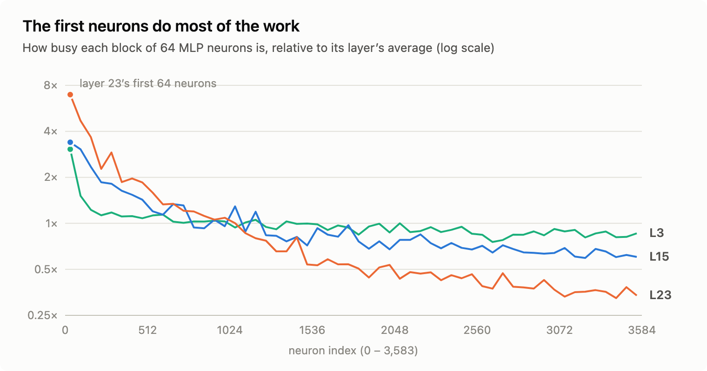
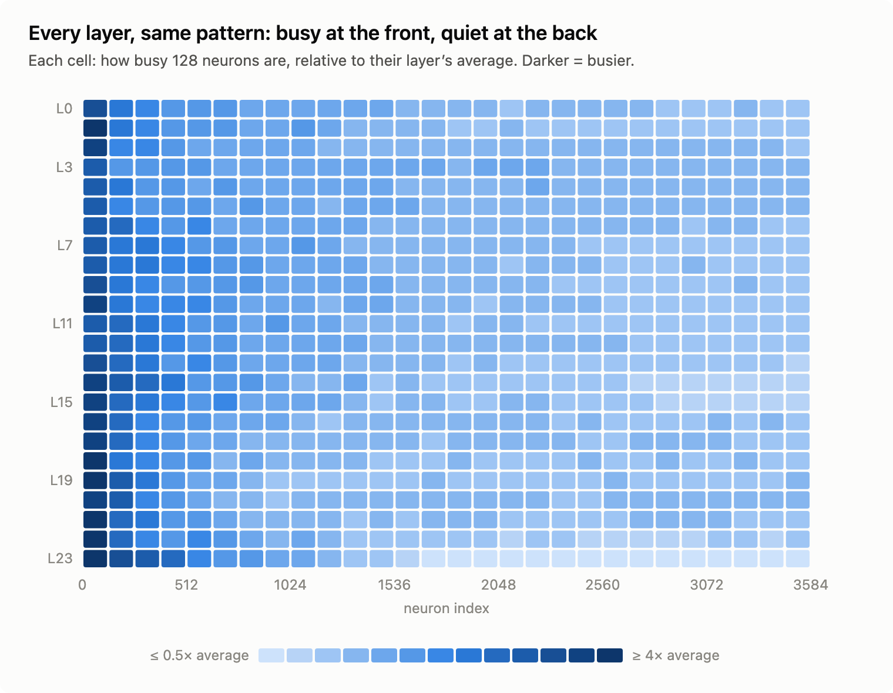
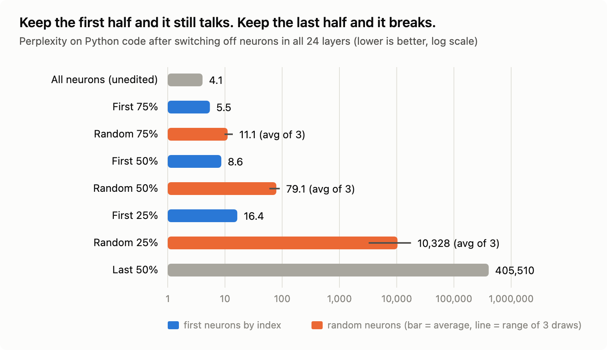

# The Neurons Are in Order (and They Shouldn't Be)


I wasn't looking for this.

I was hunting for something else entirely: the neurons that make a small language model doubt itself. Qwen3.5-0.8B has a strange habit. It writes perfectly good code, then says *"Wait…"* and argues itself out of it. I wanted to find the parts of the network responsible.

My tools handed me a list: the 64 neurons in the model's last layer that mattered most for that behaviour.

```text
28, 84, 11, 234, 36, 6, 291, 2, 57, 77, 81, 66, 15, 160, 49, 176, ...
```

I almost scrolled past it. Then I looked again.

That layer has **3,584 neurons**, numbered 0 to 3,583. If you pick 64 of them that matter, their numbers should be scattered all over that range. Mine weren't. **56 of the 64 were below 512.** That's like rolling a seven-sided die 64 times and getting a one 56 times.

Dice don't do that. Something had loaded them.

## Neurons don't have assigned seats

To see why this is strange, picture an orchestra.

Every musician sits in a numbered chair. But nobody assigned the chairs; people just sat down. If two violinists swap seats and take their sheet music with them, the concert sounds *exactly* the same. The chair number tells you nothing about who matters.

Neurons in a language model work the same way. Each of Qwen's 24 layers has a block of 3,584 neurons. Swap neuron #5 with neuron #3,000, carry their weights along, and the model computes the identical thing, to the last decimal. Mathematicians call this **permutation symmetry**. When a model is trained from random noise, nothing pushes the important neurons toward any particular number.

So neuron #0 should be as ordinary as neuron #2,817.

It isn't.

## The first chairs are where the music happens

I watched every neuron in the model while it read about 185,000 tokens: its own reasoning, Python code and plain English. For each one I asked a simple question: **how busy are you?**



The line falls off a cliff. In the last layer, the first 64 neurons are **7× busier** than the layer's average. Neurons in the back third work at about a third of the average. Of that layer's 100 busiest neurons, **93 sit in the first 512 seats**. Chance would put about 14 there.

Maybe that's one weird layer? Here are all 24:



Every row is a layer, and every row has the same dark stripe down the left side. The pattern gets *stronger* the deeper you go. Across the whole model, a neuron in the first 512 seats fires on **25%** of tokens; one in the last 512 fires on **8%**.

The orchestra isn't seated randomly. Somebody put the principal players in the front row.

## The experiment: send half the orchestra home

"Busy" isn't the same as "important". A drummer can be loud without carrying the melody. So I ran the test that settles it.

I switched off neurons in **all 24 layers at once** and measured how much the model suffered. The measure is *perplexity*, roughly how confused the model is by real text: lower is better, and the untouched model scores **4.1** on Python code. I tried three ways of choosing who goes home:

- keep the **first** neurons, by seat number;
- keep a **random** set;
- keep the **last** neurons.



| Neurons kept | First ones | Random ones | Last ones |
|---|---|---|---|
| 75% | **5.5** | 9.8 – 13.7 | |
| 50% | **8.6** | 60 – 91 | **405,510** |
| 25% | **16.4** | 3,237 – 17,788 | |

Read that middle row again.

- **The front half beats a random three-quarters.** Throwing away *half* the model in seat order (8.6) does less damage than throwing away a random *quarter* (around 11).
- **The back half is nothing on its own.** Keep only seats 1,792 to 3,583 and perplexity explodes from 4 to over **400,000**. That's no longer a language model; it's a random-number generator with a vocabulary.
- **The seat order beat my own ranking.** I also tried keeping the 50% of neurons I had *measured* as busiest. It did slightly worse (9.0) than plain seat order (8.6). Whoever arranged these neurons knew more about them than my measurements did.

## The "d d d d" moment

Numbers are one thing. I wanted to *see* it. So I gave the same coding problem to three versions of the model: check whether any two numbers in a list are closer than a threshold.

**The full model** plans like a careful student:

```text
Let me analyze the problem:
1. We need to check if in a list of numbers, are any two numbers closer
   to each other than a given threshold
2. Two numbers are "closer" if their absolute difference is less than or
   equal to the threshold
```

**The front half only** is fluent, on topic, and even starts writing the right function:

```text
We need to determine the Python function of `has_close_elements`, which is a
standard Python function, and it's to be in a single python code block.
Let's first start to make the code for the function.

def has_close_elements(numbers: List[float], threshold: float) -> bool:
```

**A random half:**

```text
dn
d
d
d
d
d
```

That's the whole answer. Just `d`, until it runs out of room.

But the front-half model has a problem of its own. It sounds right, yet it can't *finish* a thought. On 16 coding problems it solved **zero**, and every single answer went in circles until it hit the length limit:

> *"The function's function is defined, and the `count_distinct_characters` is a function that returns the number of distinct characters in a string. The function's function is defined, and the…"*

(The full model solves 5 of those 16.)

So the front of each layer holds the model's **language**: grammar, topic, even Python syntax. The **reasoning** needs the rest of the orchestra.

## Meet the cast

Once you know where to look, individual neurons turn out to have surprisingly readable personalities. I'll name them by layer and seat: **L23.N9** is seat 9 in layer 23. Each nickname comes from the text that makes that neuron fire hardest.

### The front row: workhorses that never rest

| | Neuron | What it does |
|---|---|---|
| 🥁 **The Metronome** | L19.N0 | Fires on **every single token**, at **61×** the strength of a typical neuron in its layer. It peaks on plain glue words like *"the"* and *"and"*. It's less a detector than a steady beat that the rest of the layer plays against. |
| 📋 **The Outline Keeper** | L23.N9 | Fires on the full stop in the model's private to-do list: *"3. Draft"*, *"4. Refine"*, *"5. Final"*. It keeps track of where the model is in its own plan. |
| ⇥ **The Indenter** | L23.N84 | Its peak is among the 50 strongest of all 86,000 neurons in the model, and it fires on… the spaces that indent Python code. |
| 🔢 **The Long-Number Reader** | L23.N11 | Lights up inside long numbers such as *1.5707963267948966*. |
| 🚪 **The Turn Detector** | L3.N0 | Jolts when a new chat turn begins, especially right after a block of code. |

### The specialists: quiet until their moment

These sleep through most text and wake for one kind of token. Unlike the workhorses, **they sit in every part of the layer**, front and back alike. The front row isn't where the specialists live; it's where the busy generalists live.

| | Neuron | What it does |
|---|---|---|
| ✋ **The Wait Neuron** | L16.N2734 | **56×** more active on *"Wait"* than on an average token, and silent for 90% of text. In a model that doubts its correct answers almost as often as its wrong ones, this one is a prime suspect. |
| 🔄 **The Second-Guesser** | L14.N1542 | Responds identically to *"Actually"*, *"Wait"* and *"However"* at the start of a bullet point. To this neuron they're all the same move: *take back what I just said.* |
| 🔮 **Code Is Coming** | L15.N556 | Fires on the blank line right after *"Let me write the function:"*, before a single character of code exists. It knows what's next. |
| 🚧 **The Fence Opener** | L15.N1265 | Fires on the ```` ``` ```` that opens a code block, especially after *"Let me fix this:"*. |
| 🏷️ **The `def` Detectors** | L0.N545, L15.N1126 | About **76×** more active on `def` than on anything else. One sits in the very first layer, one in the middle. |
| ↩️ **The `return` Detector** | L0.N1427 | 67× more active on `return`. |
| 🧠 **The `</think>` Detector** | L0.N744 | Fires on `</think>`, the exact moment the model stops thinking and starts answering. |

A fair warning about nicknames: neurons rarely do just one thing. These describe each neuron's strongest habit on the text I showed it, not its whole job description.

## So who arranged the orchestra?

Here's where I have to be honest: **I don't know how Qwen built this model.** But two well-known recipes leave exactly this fingerprint.

**Suspect #1: it was carved out of a bigger model.** Techniques like NVIDIA's *Minitron* take a large model, rank its neurons by importance, keep the best and retrain. If the survivors are stored in rank order, the small model inherits a sorted orchestra.

**Suspect #2: it was trained as a set of nesting dolls.** *Matryoshka*-style training (MatFormer, for example) teaches a model so that its first *k* neurons work as a complete smaller model on their own. The front of every layer would then be, by design, a model within the model.

Our front-half experiment fits either story. Cut along the seams and you get something that still speaks; cut anywhere else and it falls apart.

And the Metronome is its own clue. Single, enormously loud neurons like L19.N0 show up across many language models; researchers call them **massive activations**. They seem to act as fixed reference points rather than carrying meaning.

## Why this matters

- **There may be a smaller model hiding inside this one.** If the front of every layer is a ranked core, you can shrink the model just by slicing, with no retraining. Today the slice can talk but not reason, yet it's a far better starting point than a random cut.
- **Interpretability gets a treasure map.** If you're hunting for the neurons that matter in this model, start at the front.
- **A trap for researchers.** Plenty of studies use "a random set of neurons" as a baseline, assuming seat numbers mean nothing. In a model like this, that assumption is quietly wrong.

## What I'm *not* claiming

- This is one model. I haven't checked its siblings yet.
- The neuron profiles come from about 185,000 tokens, mostly code and coding traces. Other kinds of text might reveal other personalities.
- "Sorted by importance" is the best explanation for the evidence, not a confession. Only the people who built the model know for sure.

---

I set out to find why a small model doubts itself. I'm still working on that one. Along the way I found that its neurons are seated in order of importance, that half of them can hold a conversation but not a thought, and that one neuron spends its entire life saying *"Wait."*

That's the fun of looking inside these things. You go looking for one answer, and the model hands you a different mystery.

*If you've seen this kind of neuron ordering in other models, or know how Qwen3.5 was built, I'd love to hear about it in the comments.*
